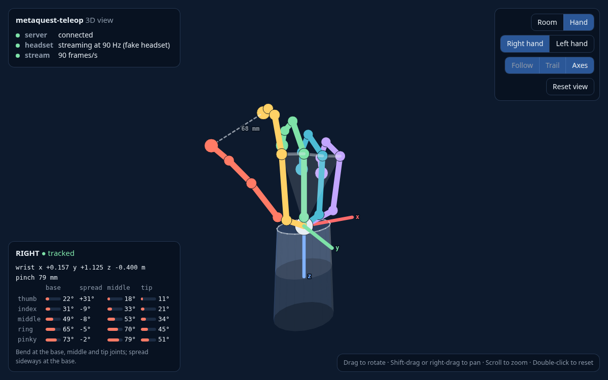

# MetaQuestTeleop

[](https://vigno0405.github.io/MetaQuestTeleop/)
[](https://pypi.org/project/metaquest-teleop/)
[](https://github.com/vigno0405/MetaQuestTeleop/actions/workflows/ci.yml)

Stream your hands from a Meta Quest to Python, to control robots. Up to 120 times a second you
get both wrists, 25 joints and 20 joint angles per hand. Nothing to install on the headset.

<p align="center">
  
</p>

**Documentation: https://vigno0405.github.io/MetaQuestTeleop/**

## Install

```bash
pip install metaquest-teleop
```

You also need `adb`, the tool that talks to the headset over USB (Ubuntu: `sudo apt install
adb`, macOS: `brew install --cask android-platform-tools`), and, once, on the headset:
developer mode and hand tracking on.
[Get started](https://vigno0405.github.io/MetaQuestTeleop/start.html) has the details.

## Run

1. Plug in the headset and run `metaquest-teleop`.
2. In the Quest's browser, open **http://localhost:8012** and press **Start**.
3. Watch your hands in the terminal, or in 3D at **http://localhost:8012/view**.

No headset? Run `metaquest-teleop --no-adb`, and `metaquest-teleop-fake` in a second terminal.

## Use it in Python

```python
from metaquest_teleop import QuestHands

with QuestHands() as quest:
    while True:
        frame = quest.wait()  # the next frame from the headset
        if frame.right is not None:
            print(frame.right.wrist.position, frame.right.pinch)
```

## License

MIT. Written by Gregorio Valenti.
