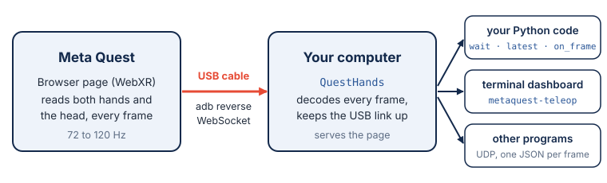

# How it works

## The page in the headset

The headset needs no app. `QuestHands` serves a small web page, and the Quest's browser
runs it. When you press Start, the page asks the browser for an immersive WebXR session with
hand tracking: `immersive-ar` (passthrough) where the headset supports it, `immersive-vr`
otherwise. It then asks for the highest frame rate the headset offers.

From then on, for every frame the headset renders, the page reads the pose of the head and of
the 25 joints of each tracked hand, packs them into one binary message and sends it to the
computer over a WebSocket. Once a second it also sends its frame count. If the connection
falls behind (more than 16 kB waiting to be sent), the page skips frames instead of piling
up delay. Pressing the Meta button ends the session; the page then waits for Start again.

## The USB link

WebXR runs only on secure pages: HTTPS, or `http://localhost`. The computer is not the
headset's `localhost`, but `adb reverse` makes it so: it forwards the headset's
`localhost:8012` through the USB cable to the computer's port 8012. The page is then
reached as `http://localhost:8012`, secure for the browser, with no certificate to set up.

`QuestHands` runs `adb reverse` itself, and checks again every two seconds while no page is
connected, so the link comes back after the cable is unplugged or the headset sleeps. With
`adb=False` (`--no-adb`) it leaves the link to you.

## The server

`QuestHands` runs an aiohttp server in a background thread, with two routes: `/` serves the
page and `/ws` receives the frames. It listens on `127.0.0.1` only: the headset reaches it
through `adb reverse`, and nothing else on the network can send it frames. Each frame is
decoded into a {py:class}`~metaquest_teleop.Frame` on arrival, handed to the `on_frame`
callbacks, sent over UDP if asked, and kept as the latest for `wait()` and `latest()`.

## The wire format

Each frame is one binary WebSocket message of 1448 bytes, little-endian: a 20-byte header,
then 357 float32 values.

| Bytes | Type | |
|---|---|---|
| 0–3 | 4 bytes | `QHS1`, the magic |
| 4–7 | uint32 | `seq`, the frame counter |
| 8–15 | float64 | `time`, the headset's clock, seconds |
| 16 | uint8 | flags: 1 head, 2 left hand, 4 right hand present |
| 17–19 | | padding |
| 20–47 | 7 × float32 | head: x, y, z, qx, qy, qz, qw |
| 48–747 | 175 × float32 | left hand: 25 joints × (x, y, z, qx, qy, qz, qw) |
| 748–1447 | 175 × float32 | right hand, the same |

A part whose flag is not set is zeros and is ignored. {py:func}`~metaquest_teleop.hands.decode`
reads a message into a `Frame`, and {py:func}`~metaquest_teleop.hands.encode` writes one; the
fake headset uses it.

Status messages travel as JSON text on the same WebSocket: `hello` when the page connects,
`session` when an immersive session starts or ends and when its frame rate changes, `stats`
once a second, and `error` when the page fails to start a session. They fill
`quest.headset` and `quest.events`.
