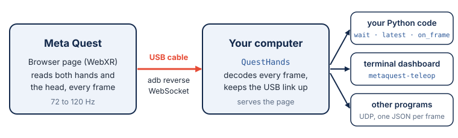
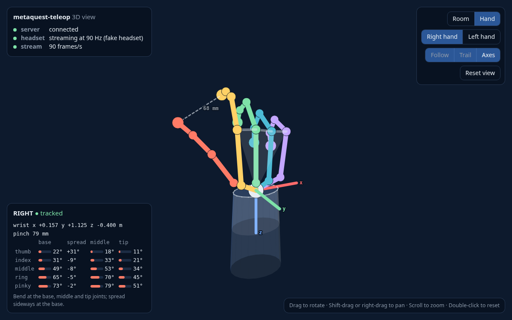

# metaquest-teleop

Stream your hands from a Meta Quest to Python, to control robots. Up to 120 times a second you
get both wrists, 25 joints and 20 joint angles per hand. Nothing to install on the headset.



## In three steps

1. `pip install metaquest-teleop`
2. Plug in the headset and run `metaquest-teleop`.
3. In the Quest's browser, open **http://localhost:8012** (with the `http://`) and press **Start**.

No headset? Run `metaquest-teleop-fake` in a second terminal. [Get started](start.md) has the
details, including the one-time setup of the headset.

## See your hands in 3D

Open **http://localhost:8012/view** on your computer, or [try it now in your
browser](view.md#try-it-here), with a fake hand.



## Use them in Python

```python
from metaquest_teleop import QuestHands

with QuestHands() as quest:
    while True:
        frame = quest.wait()  # the next frame from the headset
        if frame.right is not None:
            print(frame.right.wrist.position, frame.right.pinch)
```

More in [Use it in Python](python.md).

## Drive a robot

Your right hand drives the robot; pinch your left hand to pause it, and it holds when a hand is
not seen ([Teleoperation](teleop.md)). `metaquest-teleop` publishes it all on [ROS 2](ros.md),
Humble or Jazzy, whenever it finds ROS. Driving the ADAPT hand? See [ADAPT Hand](adapt.md).

Written by Gregorio Valenti and Lorenzo Vignoli. MIT license. Source on
[GitHub](https://github.com/vigno0405/MetaQuestTeleop).

```{toctree}
:hidden:
:caption: Getting started

start
view
troubleshooting
```

```{toctree}
:hidden:
:caption: Using it

python
teleop
ros
data
```

```{toctree}
:hidden:
:caption: ADAPT Hand

adapt
```

```{toctree}
:hidden:
:caption: Reference

api/index
changelog
```
