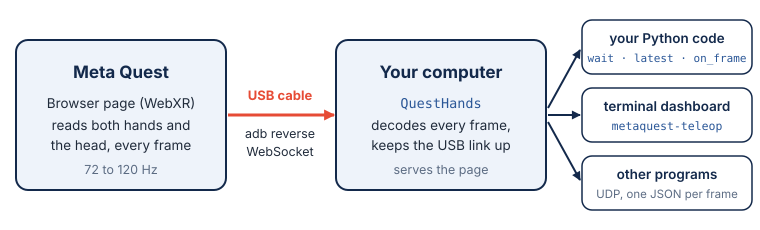

# metaquest-teleop

`metaquest-teleop` streams hand tracking from a Meta Quest to Python over a USB cable, to
teleoperate robots. Every frame the headset renders, up to 120 times a second, gives you the
pose of both wrists, the 25 joints of each hand and 20 joint angles per hand. There is
nothing to install on the headset: it runs a web page in the Quest's own browser.



A few lines get the right wrist into your program:

```python
from metaquest_teleop import QuestHands

with QuestHands() as quest:  # then open http://localhost:8012 in the Quest browser
    while True:
        frame = quest.wait()  # the next frame from the headset
        if frame.right is not None:
            print(frame.right.wrist.position, frame.right.pinch)  # metres
```

## Install

```bash
pip install metaquest-teleop
```

[Installation](installation.md) covers virtual environments, conda, ROS 2, `adb` and the
one-time setup of the headset.

## Where to start

The [quickstart](quickstart.md) gets the first frames on screen, with the headset or without
it. The guides then go through the library by task: [receiving frames in
Python](guides/python.md), [teleoperating a robot](guides/teleoperation.md) with a clutch, a
gripper and a frame change, [the command line](guides/command-line.md) and its dashboard, and
[other programs and languages](guides/udp.md) over UDP.

The concepts explain [the data](concepts/data.md) (units, frames, joints and angles) and
[how it works](concepts/how-it-works.md): the page in the headset, the USB link and the wire
format. The [API](api/index.md) lists every class and function.

## Authors

`metaquest-teleop` is written by Gregorio Valenti. The source is on
[GitHub](https://github.com/vigno0405/MetaQuestTeleop), under the MIT license.

```{toctree}
:hidden:
:caption: Getting started

installation
quickstart
troubleshooting
```

```{toctree}
:hidden:
:caption: Guides

guides/python
guides/teleoperation
guides/command-line
guides/udp
```

```{toctree}
:hidden:
:caption: Concepts

concepts/data
concepts/how-it-works
```

```{toctree}
:hidden:
:caption: Reference

api/index
changelog
```
