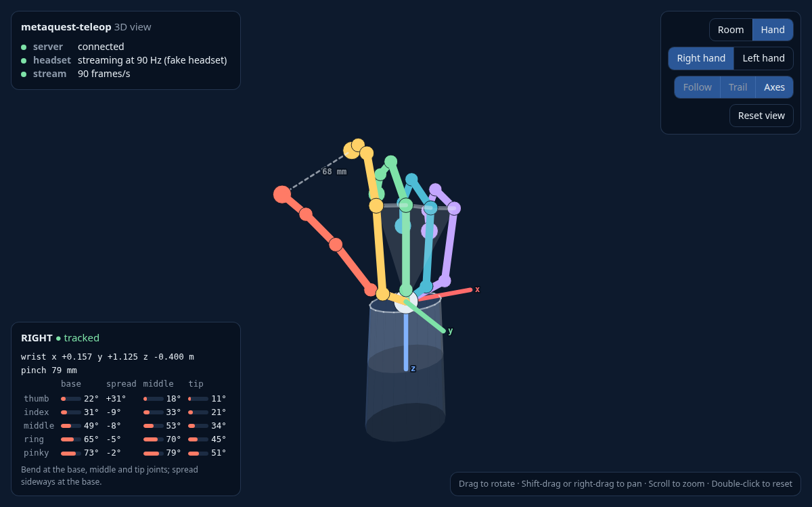
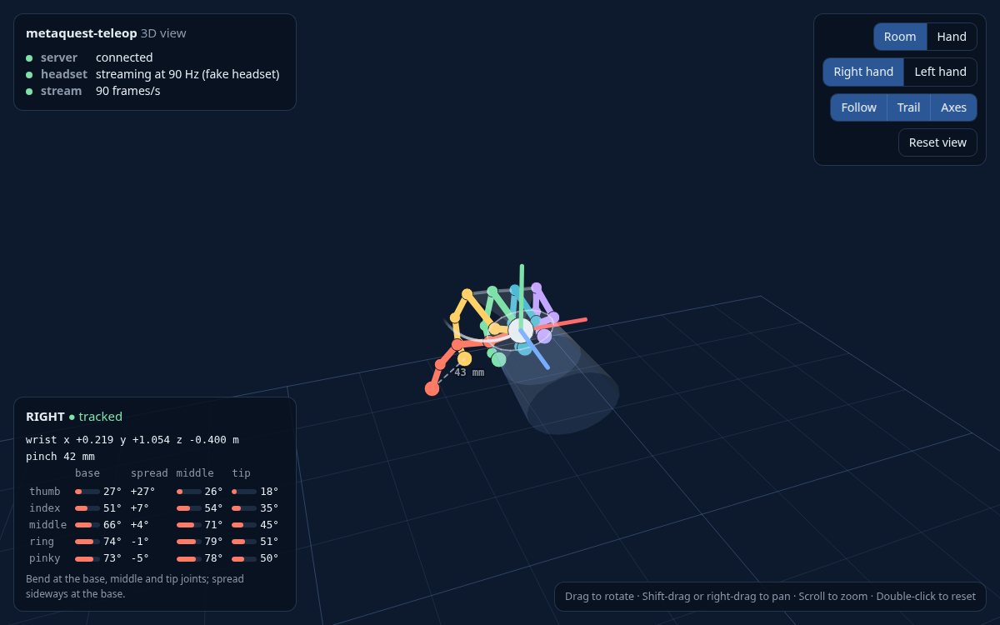

# 3D view

A live 3D picture of the hands, in a browser on your computer, to check that everything works,
with the headset or with the fake one. While `metaquest-teleop` (or your script) runs, open
**http://localhost:8012/view**.

## Hand

The hand stays still in the middle of the screen and only the fingers move. Use it to check
the fingers, for example before driving a robot hand.

## Room

Both hands where they are, over the floor, seen from about where your eyes are, with the
wrist's path over the last two seconds.

## How to read it

- The grey **sleeve** is the start of the forearm; its blue side is the palm side.
- Fingers: thumb red, index yellow, middle green, ring blue, pinky violet.
- Axes: x red, y green, z blue.
- The dashed line is the pinch: thumb tip to index tip, in millimetres.
- The panels show the connection and, for the selected hand, its wrist position, pinch and
  joint angles: how much each joint bends (base, middle, tip) and how far the finger spreads
  sideways. See [the data](data.md#angles).

## Controls

| | |
|---|---|
| Drag | rotate |
| Shift-drag or right-drag | move |
| Scroll | zoom |
| Double-click | reset the view |

Pick the view and the hand at the top right. `http://localhost:8012/view?mode=hand&hand=right`
opens the hand view of the right hand directly.
